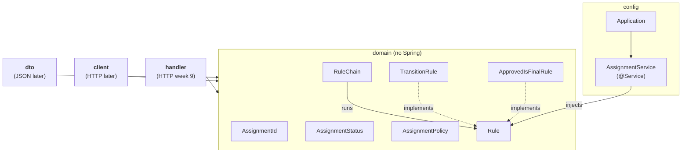

# Product

This project is a simple web-based system for managing homework assignments.
It allows teachers and students to follow the progress of an assignment from
the moment it is assigned until it is finally approved.

# Core item

The main entity of this project is an **Assignment**.
Each assignment has a unique identifier and a status that shows its current
stage in the homework process.

# Status table

| From | To | Allowed? | Business reason |
|------|----|----------|-----------------|
| ASSIGNED | SUBMITTED | Yes | The student submits the assigned homework. |
| SUBMITTED | CHECKED | Yes | The teacher checks the submitted homework. |
| CHECKED | ASSIGNED | No | A checked assignment cannot return directly to the initial state. |
| APPROVED | SUBMITTED | No | An approved assignment is already completed and cannot be submitted again. |

# Forbidden transitions

## CHECKED → ASSIGNED

This transition is not allowed because the assignment has already been checked.
Sending it back to the **ASSIGNED** state would break the normal order of the
homework process.

## APPROVED → SUBMITTED

This transition is also not allowed because an approved assignment is already
finished. Once it is approved, it cannot be submitted again.

# Rules

The transition logic lives in small `Rule` implementations (plain Java, no Spring).
`RuleChain` runs them in order and stops at the first failure.

| Rule | Enforces | Status table rows |
|------|----------|-------------------|
| ApprovedIsFinalRule | Stop-factor: an approved assignment is finished | APPROVED → SUBMITTED (No) |
| TransitionRule | Only the listed transitions are allowed | ASSIGNED → SUBMITTED, SUBMITTED → CHECKED, CHECKED → APPROVED (Yes); CHECKED → ASSIGNED (No) |

#Architecture

Arrows point inward, and `domain` never imports `org.springframework`.

# Database (JPA + Flyway)

PostgreSQL only. The development URL is
`jdbc:postgresql://localhost:5432/css`, user `css`, password `css`.
The schema is owned by Flyway: migrations live in
`project/src/main/resources/db/migration` (`V1__create_assignment.sql`) and
run on application start.
Hibernate only validates the schema (`spring.jpa.hibernate.ddl
auto=validate`), it never changes it. To change the table, add a new
`V2__...sql`, never edit an applied migration.
A database created earlier from the old `schema.sql` is baselined at version 1
automatically (`baseline-on-migrate`).

| Column | Meaning |
|--------|---------|
| `id` | surrogate key, `AssignmentId.newId()` |
| `business_key` | human number such as `HW-1042`, `UNIQUE NOT NULL` |
| `status` | text, `CHECK` in `ASSIGNED, SUBMITTED, CHECKED, APPROVED` |
| `title` | text, `NOT NULL` |

Packages: `domain` (no JPA, no Spring), `persistence`
(`AssignmentEntity`, `AssignmentRepository` as Spring Data JPA,
`AssignmentStatusConverter`, `AssignmentRecord` read model),
`config` (`AssignmentService` with `@Transactional`).
A duplicate `business_key` becomes `DuplicateAssignment` (unchecked, in `domain`).

# Run

| Profile | How | Database |
|---|---|---|
| dev (default) | `mvn spring-boot:run` | `localhost, db/user/password 'css'` |
| prod | `SPRING_PROFILES_ACTIVE=prod` + `CSS_DB_URL`, `CSS_DB_USER`, `CSS_DB_PASSWORD`, `CSS_DNSHOWDOWN` | from env |

API: `POST /api/v1/assignments`, `GET /api/v1/assignments/{id}`.

Swagger UI: `/swagger-ui.html`. Spec: `/v3/api-docs`. Health: `/actuator/health`.

## PostgreSQL setup on Windows

These steps are for a teammate setting up the project for the first time.
The password requested by `psql` is the password of the PostgreSQL role, not
the Windows password and not the application login password.

1. Install PostgreSQL and remember the password of the administrator role
   (usually `postgres`). During installation, leave the port as `5432`.
2. Open **Services** in Windows and start the PostgreSQL service. Its name
   usually looks like `postgresql-x64-...`. It must be running before starting
   the application.
3. Open **SQL Shell (psql)** from the PostgreSQL start menu, or open
   PowerShell if `psql` is in `PATH`. Connect as the administrator:

   ```powershell
   psql -U postgres -h localhost -p 5432 -W
   ```

   Enter the administrator password chosen during PostgreSQL installation.
   Nothing is displayed while typing a password; this is normal.
4. In the psql window, create the application role and database. These
   commands are safe to run again:

   ```sql
   DO $$
   BEGIN
       IF NOT EXISTS (SELECT FROM pg_roles WHERE rolname = 'css') THEN
           CREATE ROLE css LOGIN PASSWORD 'css';
       ELSE
           ALTER ROLE css WITH LOGIN PASSWORD 'css';
       END IF;
   END
   $$;

   SELECT 'CREATE DATABASE css OWNER css'
   WHERE NOT EXISTS (SELECT FROM pg_database WHERE datname = 'css')\gexec
   ```

   Exit psql with `\q`.
5. Verify the exact credentials used by the application:

   ```powershell
   psql -U css -d css -h localhost -p 5432 -W
   ```

   When prompted, enter `css`. If this succeeds, the database connection is
   ready. Do not run `cd` commands inside the psql window.
6. In a new PowerShell window, from the repository root, start the application:

   ```powershell
   cd ".\project"
   mvn spring-boot:run "-Dspring-boot.run.arguments=--app.cli.enabled=true"
   ```

   Flyway creates the tables automatically. No manual `CREATE TABLE` command
   is needed.

### PostgreSQL connection errors

- `psql is not recognized`: start **SQL Shell (psql)**, or add PostgreSQL's
  `bin` directory (for example `C:\Program Files\PostgreSQL\16\bin`) to
  `PATH`.
- `connection refused`: the PostgreSQL service is stopped, or PostgreSQL is
  listening on a different port. Check the service and use port `5432`.
- `password authentication failed for user "css"`: the role exists with a
  different password. Connect as `postgres` and run
  `ALTER ROLE css WITH PASSWORD 'css';`, then retry the verification command.
- `database "css" does not exist`: connect as `postgres` and run
  `CREATE DATABASE css OWNER css;`.
- `password authentication failed for user "postgres"`: use the administrator
  password created during PostgreSQL installation, or reset it in pgAdmin.

## Terminal menu

After starting PostgreSQL (the table is created by Flyway), run the
application with its
interactive English-language menu:

```powershell
cd ".\project"
mvn spring-boot:run "-Dspring-boot.run.arguments=--app.cli.enabled=true"
```

The menu allows you to:

1. create an assignment;
2. show all assignments;
3. find an assignment by key;
4. change the status while checking transition rules;
0. exit.

Creating an assignment and changing its status are saved in the `assignment` table.
The status values are `ASSIGNED`, `SUBMITTED`, `CHECKED`, and `APPROVED`.

### Login and roles

Start the menu with `mvn spring-boot:run "-Dspring-boot.run.arguments=--app.cli.enabled=true"`.

| Role | Create assignment | Show / find | Change status |
|------|-------------------|-------------|---------------|
| STUDENT | no | yes | only to SUBMITTED |
| TEACHER | yes | yes | only to CHECKED or APPROVED |

Registration in the menu creates a `STUDENT` only. Dev demo users are
`teacher / teacher123` and `student / student123`; production has no demo
users. Passwords are stored as PBKDF2-HMAC-SHA256 hashes with random salts.